<a href="https://murilogp.dev">
  <picture>
    <source media="(prefers-color-scheme: dark)" srcset="./assets/banner-dark.svg">
    <source media="(prefers-color-scheme: light)" srcset="./assets/banner-light.svg">
    
  </picture>
</a>

Desenvolvedor full stack com foco em front-end, estudando Análise e Desenvolvimento de Sistemas no Senac, em São Paulo. Construo aplicações web completas com **React, Next.js, TypeScript e Supabase**: autenticação, segurança no banco com RLS, pagamentos via API, testes e deploy na Vercel. Antes disso, trabalhei como designer gráfico e motion designer freelancer.

### No que estou trabalhando

- **[NotchMuc](https://notchmuc.murilogp.dev)** · Ilha estilo Dynamic Island para Windows e macOS, com o Mucky, um assistente de IA que roda 100% local. `Tauri` `Next.js` `Supabase` `Stripe` `llama.cpp`
- **[Salão Bio](https://salaobio.com.br)** · Agendamento online para barbearias, salões e estúdios, com página própria para cada loja. `Next.js` `TypeScript` `Tailwind CSS` `Supabase` `PWA`

### Projetos abertos

| Projeto | O que é | Stack |
| --- | --- | --- |
| [portifolio](https://github.com/murilogpapa/portifolio) | Este portfólio ([murilogp.dev](https://murilogp.dev)), em estilo blueprint com tema claro e escuro | Next.js · TypeScript · Tailwind CSS |
| [webgarage](https://github.com/murilogpapa/webgarage) | Site de concessionária com consulta de preços pela API da Tabela FIPE, Projeto Integrador do 2º semestre de ADS | Angular · TypeScript |
| [PI-bcc-1sem](https://github.com/murilogpapa/PI-bcc-1sem) | Jogo web estilo runner, do 1º semestre de Ciência da Computação | p5.js · JavaScript |
| [RPG-Tic-em-Trilhas](https://github.com/murilogpapa/RPG-Tic-em-Trilhas) | RPG de terminal ambientado em Midgard, do curso de Swift Tic em Trilhas | Swift |

### Stack

<picture>
  <source media="(prefers-color-scheme: light)" srcset="https://skillicons.dev/icons?i=ts,js,react,nextjs,tailwind,angular,nodejs,supabase,postgres,mysql,mongodb,git,vercel,tauri,py,java,swift,ps,ae,pr,blender,arduino&perline=11&theme=light">
  
</picture>

Também uso Claude Code e agentes de IA no dia a dia, LLMs locais (llama.cpp, Ollama) e ESP32 para protótipos de IoT.

### Contato

Aberto a novas oportunidades em desenvolvimento de software.

[murilogp.dev](https://murilogp.dev) · [LinkedIn](https://www.linkedin.com/in/murilogiampiccolopapa/) · [murilopapag@gmail.com](mailto:murilopapag@gmail.com)
